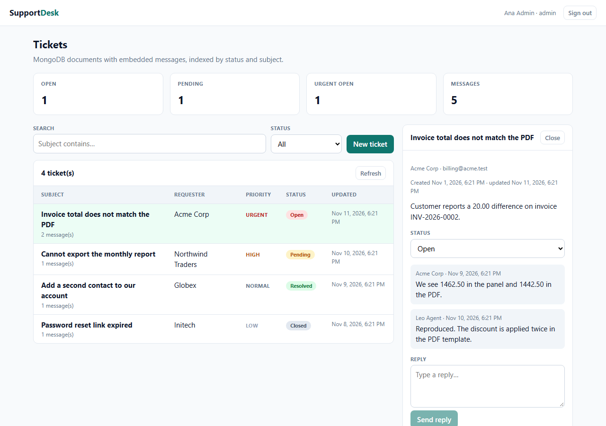

# Support Desk

A support ticket API on **Express 5 + MongoDB** with cookie sessions, role-based access, and a **React** admin panel.

**Static demo (in-memory data, no backend):** https://bluefang05.github.io/node-mongo-support-desk/



## What it does

- **Session auth** with `express-session` (httpOnly cookie) and scrypt password hashing; no JWT in localStorage.
- **Tickets** stored as MongoDB documents with embedded messages, a status workflow (`open → pending → resolved → closed`), priority, requester and tags.
- **RBAC**: every authenticated user works tickets; only `admin` can delete them.
- **Search and filters** with pagination (`status`, `q`, `page`, `limit`), plus a `$group`/`$size` aggregation for the stats cards.
- **Indexes** created on connect: `{status, updatedAt}` for the list query and a text index for search.

## Stack

Node 20+ · Express 5 · MongoDB (official driver) · express-session · Zod · React 19 · Vite · `node:test` + Supertest + `mongodb-memory-server`.

## Run it

```bash
npm install

# Option A: you already have MongoDB on 27017
npm run seed && npm start

# Option B: no MongoDB installed — run the real mongod binary in memory
npm run db:memory      # terminal 1
npm run seed           # terminal 2
npm start              # terminal 2
```

Open <http://127.0.0.1:3000/> and sign in:

| Email | Password | Role |
| --- | --- | --- |
| `admin@desk.test` | `password` | admin |
| `agent@desk.test` | `password` | agent |

The React admin is served by Express from `public/`. For frontend work: `cd web && npm run dev` (port 5174, `/api` proxied to 3000).

## API

| Method | Path | Notes |
| --- | --- | --- |
| POST | `/api/login` | sets `desk.sid` cookie |
| POST | `/api/logout` | destroys the session |
| GET | `/api/me` | current user or 401 |
| GET | `/api/tickets?status=&q=&page=` | paginated list |
| POST | `/api/tickets` | subject, description, priority, requester, tags |
| GET | `/api/tickets/:id` | one ticket |
| PATCH | `/api/tickets/:id` | status, priority, assignee |
| POST | `/api/tickets/:id/messages` | append a reply |
| DELETE | `/api/tickets/:id` | **admin only** |
| GET | `/api/stats` | aggregation: counts, urgent open, messages |

Validation is Zod-based and returns `422` with field errors. Unknown ids and malformed ids both return `404`.

## Tests

```bash
npm test
# 12 tests, each against a real mongod started by mongodb-memory-server
```

They cover anonymous rejection, bad credentials, session persistence, server-owned fields, validation errors, filtering and search, 404s, message appends, the admin-only delete, the stats aggregation and logout.

## Design notes

- **Sessions, not JWT** — the browser never holds a token that JavaScript can read; the cookie is `httpOnly` and `sameSite=lax`.
- **Embedded messages** keep a ticket's thread in one document, which matches how the UI reads it. A high-volume deployment would move messages to their own collection.
- **`express-session` MemoryStore** is for the demo only; production should use a shared store (`connect-mongo`) so sessions survive restarts and multiple instances.
- **Search** is a case-insensitive regex on the subject; the text index is there for the next step (`$text` with ranking and pagination by score).

## How this was built

AI-assisted workflow: drafts generated, every change reviewed, and the test suite (against a real MongoDB) as the gate.
